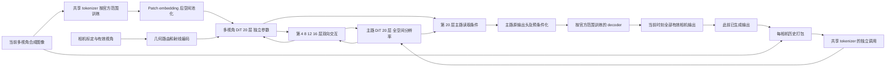

# 双路 DiT 架构与训练设计

## 设计目标

以官方训练机制为基础，让原单路 DiT 按官方参数范围持续学习，新增另一条有独立深度和参数的 DiT，处理多视角 latent 并反复参与生成。两路从训练开始共同优化，主路输出完整的协调结果；条件路通过最终主损失学习，不单独预测 RGB、噪声或相对输入的图像残差。

本方案默认任务是现有项目中的插入资产协调与修复，推理可见当前合成输入、相机标定和此前生成结果。配对目标及评估资产 mask 只用于监督或评估。这里的“条件输入”不代表干净 GT；多视角图像也可能包含待修复的资产。

推荐先实现完整双路，再用消融判断深条件路是否值得。官方训练设置的依据见 [TRAINING_REFERENCE.md](TRAINING_REFERENCE.md)；交互层位、可变视角分组和生成历史训练属于本方案的扩展选择。

## 原模型约束

本地 `runtime_contract.py` 指定原 DiT 为 20 层、宽度 1280、20 个注意力头、16 通道 latent、空间 patch 为 2、时间 patch 为 1。以严格加载后的实际对象再次核查，不从模型名称推断结构。

核查范围是本地保存的官方训练参考版本。README 的训练命令显式设置 `--train_full_unet --timestep 250`，训练器调用 `net_pix2pix(x_src)`，模型 `forward()` 按固定 timestep 调用一次 `denoise(...).x0`。该训练调用链没有加入随机噪声或随机采样 timestep；`use_sched` 在这份 forward 中也没有触发多步采样。不能将 CLI 默认 `999` 或单独的推理参数当成训练配方。所选官方配方的训练与推理共享以下参数化：

```text
z = 原 tokenizer 编码并按官方约定缩放输入
sigma = timestep / 1000 = 0.25
F = DiT(c_in(sigma) * z, c_noise(sigma), 官方条件)
z_hat = c_skip(sigma) * z + c_out(sigma) * F
y_hat = 原 tokenizer 解码 z_hat
```

它对输入图像 latent 做一次协调。新模型保留这套预条件化、最终输出头、缩放和解码约定；训练的 `250` 由已核查的官方训练配方提供，推理配置单独记录。若更换官方训练版本，必须重新核查噪声策略和目标，不能机械沿用该常数。

`z_hat` 是完整预测 latent；上式已有的 `c_skip` 是官方参数化的一部分。方案不额外定义 `y_hat = input + delta_image` 或要求新增分支学习 `GT - input`。交换模块内部的特征残差只承担信息融合和稳定初始化。

## 双路结构



图中层号从 1 开始，配置中的 block 索引从 0 开始。循环箭头表示分层交互与跨时刻历史反馈；单次前向是有限的顺序计算。

| 项目 | 主路 S | 多视角路 M |
| --- | --- | --- |
| 职责 | 当前相机的协调与最终生成 | 聚合当前时刻各相机的条件与几何信息 |
| 参数 | 原官方 Harmonizer DiT 权重 | 从已严格加载的同一 DiT 克隆独立参数 |
| 深度与宽度 | 20 层，1280，20 头 | 20 层，1280，20 头 |
| 输入 | 当前输入和本相机生成历史的 temporal latent | 当前输入单独以 T1 编码的多视角 latent |
| 空间分辨率 | 原生 patch token 网格 | patch embedding 后，H/W 各池化 2 倍 |
| 时间范围 | 当前输入及过去已生成历史 | 仅当前时刻，T1 |
| 原生 self-attention | 每相机内部处理，不混入其他相机 batch | 每相机内部处理，另加显式跨视角交互 |
| 输出头 | 保留，负责唯一最终输出 | 不建立 RGB 或 latent 预测头 |
| 全程训练 | 自第一个优化步起训练全部 20 个 block、embedding、norm 和原输出头 | 同时训练全部克隆块、embedding 和新交互模块 |

条件路是采用 DiT 块和相同噪声条件接口的条件 transformer，不是第二个独立采样的生成器。它接受与主路匹配的 `c_noise`，但输入无需加独立噪声。两路的权重初值相同，训练参数不共享；它们的输入、空间分辨率、几何交互和优化范围不同。

共享 tokenizer 权重，不共享可变编码缓存。沿用官方推荐命令的 `freeze_vae=false`、`freeze_vae_encoder=false`，训练 encoder/decoder 中除名称含 `time_conv` 外的参数。条件路编码不得覆盖主路的 VAE skip activations；若实际配置启用这些缓存，分别保存与恢复。两次编码都允许梯度进入共享 encoder，共享参数在优化器中只注册一次。decoder 保留到 latent 的梯度，同时更新其官方可训练参数。推理用 `eval/no_grad`，训练不得复用带梯度屏蔽的推理包装。

## 张量与位置编码

用 `t` 表示外部物理时间，用 `tau` 表示打包后的 latent 时间槽，禁止混用相机数与时间长度。

| 张量 | 布局 |
| --- | --- |
| 当前图像 | `[B,V,3,H,W]` |
| 当前及历史 RGB | `[B,T_rgb,V,3,H,W]` |
| tokenizer 输入 | `[B*V,3,T_rgb,H,W]`，只合并 B 和 V |
| 主路 latent | `[B,V,C_z,T_lat,h,w]` |
| 主路 patch token | `[B,V,T_lat,N,D]`，`N=(h/2)*(w/2)` |
| 条件路当前 token | `[B,V,M,D]`，整除时 `M=N/4` |
| 当前相机标定 | `K: [B,V,3,3]`，`T_ego_from_cam: [B,V,4,4]` |
| 路由掩码 | `[B,V_destination,V_source]` |

`C_z=16`、`D=1280` 作为当前底座的断言；`h,w,T_lat` 从 tokenizer 实测输出读取。T5 RGB 通常对应 T2 latent，禁止按五个 RGB 帧硬索引五个 latent 槽。相机从不作为 tokenizer 的时间轴。

主路沿用原 RoPE。条件路的池化 token 使用原网格覆盖区域的中心坐标生成空间位置编码；不能直接把池化后索引当作原图坐标，也不能在 RoPE 已作用后再任意平均旋转后的 token。

当前图像的相机射线使用缩放、裁剪、padding 后的内参计算。令 `d_cam = normalize(K^-1 [u,v,1])`，`o` 和 `d` 变换到同一 ego/world 坐标，射线特征为 `[d, o × d]`。只归一化方向，平移量以米记录并使用固定尺度归一化；不破坏 moment 与长度尺度的关系。新几何 MLP 仅进入条件路和交互模块，不改变主路原位置编码。相机 ID embedding 是身份提示，不能替代标定。

## 跨视角与双路交互

在索引 `3,7,11,15,19`，先完成两路各自的原生 block，再更新条件路的跨视角特征，再执行两路交互。

跨视角模块用条件路目标相机 token 作 Q，几何路由允许的源相机池化 token 作 K/V：

```text
M_v_geo = M_v + tanh(g_geo) * CA_geo(
    Q=LN(M_v), K/V=LN(concat(M_u for u in allowed(v))), geometry_bias)
```

双路模块仅连接同一相机、当前 latent 槽。设 `S_v_cur` 是当前槽的全空间 token，`M_v_geo` 是该相机已经融合其他视角的条件 token：

```text
delta_S = CA_SM(Q=LN(S_v_cur), K/V=LN(M_v_geo))
delta_M = CA_MS(Q=LN(M_v_geo), K/V=LN(pool(S_v_cur)))
S_v_cur_new = S_v_cur + tanh(g_SM) * delta_S
M_v_new     = M_v_geo + tanh(g_MS) * delta_M
```

两项 delta 都从更新前的特征快照计算，防止代码执行顺序造成隐式不对称。其他主路 latent 槽不被跨视角模块直接写入。主路自身的后续 block 仍能利用历史 token。

前四个交互层执行两方向；最后一层只算 `delta_S`。最后再更新 M 没有后续消费者，会产生不影响输出的参数，因此不构建该反向模块。全方案有 5 个 `M→S`、4 个 `S→M`、5 个条件路跨视角模块。

交互投影维度建议为 320、8 头，输出投影回 1280。两路仍是完整 1280 维 DiT，这个瓶颈只限制额外交互的开销。主路读取条件的注意力保留全空间 Q，避免将小资产的主路位置也平均掉。条件路初版池化因子 2；用因子 1 做细节保留消融。

所有新门控初始化为 0，注意力输出投影保持非零随机初始化。训练前关闭新模块时，主路和 VAE 应与官方初始化在相同输入上等价。主路第一次 backward 就从官方主损失获得梯度；新增路径第一步可能仅最外层门控得到非零梯度，条件路和更深的嵌套门控随外层开启逐步接入。不要同时将 gate 与输出投影全置零。验收应分阶段检查梯度传播，不要求串联零门控后的所有模块在同一步立即都有梯度，也不以此为由冻结主路。

这仍然是完整双路模型：条件路有自己的 20 层语义变换和跨视角推理。门控残差只是交换信息的方式，不要求最后只输出修复差值。

## 几何路由与异步相机

沿用已有 T4 pose-routing 的几何思想与经核查的实现接口，按标定和视锥重叠选择来源，不按固定六相机环连边。初始候选参数沿用本地配置：8×16 射线采样、1–80 米对数深度 16 点、重叠阈值 0.01、top-k 为 2、包含边界同分候选。同分策略意味着实际邻居可能超过 2，必须按实际边数计算成本。

几何路由给出潜在可见候选，不等于精确对应或真实遮挡判定。初版不宣称同位置 token 跨相机天然对齐，也不使用未验证的深度直接强制像素匹配。

相机存在曝光时间差时，需要每相机曝光时间的 ego pose，将外参变换到共同参考时刻，再进行静态场景的射线/视锥比较。动态资产还需要一致的轨迹与时间信息；仅做 ego motion 补偿不能保证动态目标对齐。无法验证时间或资产身份的边应剔除，不能让最近帧匹配静默通过。

缺失必要标定时报错；有效标定但没有其他重叠相机时，跨视角 delta 为零，条件路仍能提供同相机上下文。单视角输入是显式退化模式，不计作多视角收益。无效视角不执行 tokenizer 或原生块，可按有效集合打包或按数量分桶；不能只补零后当作正常相机。注意力无合法 K/V 时直接返回零 delta，避免全负无穷 softmax 产生 NaN。

## 自回归时间协议

外部按时间升序处理序列，同一时刻的有效相机可并行。当前输入只用当前合成图像，历史只能来自已经生成并提交的输出，不能来自 GT、真实原始历史或未来帧。

定义新协议 `ar_generated_repeat_oldest_v1`：

1. 序列首时刻只有当前帧，使用 T1。
2. 从第二时刻起，使用 `[current, latest_prediction, ...]`。历史不足 4 帧时，重复最早的已生成历史补足 4 帧。
3. 例如第三时刻输入为 `[x_2, y_hat_1, y_hat_0, y_hat_0, y_hat_0]`。历史充足后输入为 `[x_t, y_hat_(t-1), ..., y_hat_(t-4)]`。
4. 只发布当前槽的解码结果；不能把同次解码出来的其他槽当成新生成的未来帧。
5. 全部有效相机当前输出完成后提交该时刻结果，再推进到下一时刻。

重复的是已生成结果，不是 GT 或未来帧；记录真实 timestamp 和重复标志，不把重复帧伪称为不同曝光。该策略是新协议，必须在训练中覆盖。它不同于本地旧驱动“前四次全部 T1”的启动方式，旧驱动和旧结果不能直接当作同协议对照。

推荐历史使用发布 PNG 重新读取后的 RGB，确保恢复运行和训练 rollout 一致；训练时对历史量化与 detach，禁止偷偷改为无限精度缓存。同一个实验的所有对照必须使用同一协议。若采用浮点历史，应另立协议并重新生成全部对照。

当前执行版本已将这项实现选择明确登记为 `ar_generated_repeat_oldest_native_rgb_v1`：缓存原生分辨率 uint8 往返后的 RGB，像素等价于同分辨率无损 PNG 读回，训练时不实际落盘每张历史图。评估发布尺寸的缩放不进入历史反馈。后续推理和所有对照以运行配置的协议为准，详见 [RUNNING.md](RUNNING.md)，不能将该实现与先缩至评估尺寸再反馈的结果混比。

每相机历史按 scene、资产组合及轨迹、相机身份、渲染版本隔离。相机缺测不生成伪输出，重新出现时仅使用符合时间间隔阈值的本相机历史；没有合格历史时标记新轨迹启动。不可为了缺测频繁重置全部相机以绕过自回归要求。

跨视角交换仅作用于当前 latent 槽，条件路也只编码当前图像，因此无需把 T5 压缩历史错误地对应到当前相机外参。更复杂的跨时间几何交互属于后续版本。

## 官方主损失与联合训练

新训练接口将当前配对协调 GT 作为监督，保留官方 `output_pixel_values` 的目标语义，禁止沿用不明含义的 `target_in_main_loss` 配置开关。GT 只进入 loss，不进入两条条件路径或历史队列。若数据中的“GT”实际上是去除资产的背景，则它不适合直接监督资产保留，必须先修正配对语义。

所选官方推荐命令的主损失为：

```text
pred, target: 当前输出和对应 GT，沿用官方 [-1, 1] 图像范围
L_mse = mean((pred.float() - target.float()) ** 2)
L_perceptual = mean(clamp(LPIPS_VGG(pred.float(), target.float()), 0, 0.3))
L_main = 1.0 * L_mse + 0.3 * L_perceptual
L_total = L_main
```

LPIPS 的网络权重冻结，但必须保留对预测图的梯度。先将每个 LPIPS 输出截断到 `[0,0.3]`，再求均值并乘 `0.3`；截断阈值与损失系数是两个不同设置。MSE 使用原浮点图像，不先量化，不替换成 RGB L1；保留完整预测输出的监督，不改为噪声、velocity 或残差目标。

官方训练器 `LOSS_INPUT_ONLY=True` 取的是每个样本的当前图像槽。双路实现应对每个有效相机取当前时间槽，再按有效当前相机图像平均损失；不是仅监督第一个相机，也不把生成历史当作配对 GT。图像级 MSE/LPIPS 的定义不变，跨相机与 rollout 的外层样本组织是扩展，DDP 与梯度累积需按总有效图像数正确归一化。

GAN、Gram、CLIP similarity、optical-flow 项按所选官方命令及默认值均为 0，不因代码中存在分支就启用。资产 L1、额外 RGB L1、latent L1 默认均为 0，仅作为后续有独立配置的附加损失消融，不能替换 `L_main`。若未来启用 latent loss，共享 encoder 此时可训练，必须另行定义稳定 target 编码器或 stop-gradient 策略及对齐契约。

本次“保留官方训练损失”的要求限定地覆盖旧方案对训练 LPIPS 的排除；它仅作为训练优化项及训练 loss 日志，不加入验证或测试质量指标。评估仍遵守固定九项集合，不计算 PSNR、SSIM 或 LPIPS 分数。

| 训练组件 | 从第一个优化步开始的设置 |
| --- | --- |
| 主路 DiT | 全部 20 层、embedding、norm、原输出头联合优化；无冻结预热或末五层限制 |
| 多视角条件路 | 所有被使用的独立参数进入同一训练任务，通过 `L_main` 反传 |
| 交互和几何模块 | 与两路一起优化，零门控逐步建立有效梯度 |
| 共享 VAE | encoder/decoder 按官方范围更新，名称含 `time_conv` 的参数冻结 |
| 感知损失网络 | 参数冻结，保留对预测图的梯度 |

优化器沿用官方推荐命令和解析器：AdamW，主路及 VAE 的学习率 `2e-5`，betas `(0.9,0.999)`，eps `1e-8`，weight decay `0.01`，梯度裁剪 `1.0`，BF16；学习率 scheduler 为 `constant`。解析器虽有 `lr_warmup_steps=500`，constant scheduler 不因此成为预热日程，不新增冻结阶段或逐层解冻。

新增条件路、交互与几何参数默认也用 `2e-5`，这是便于隔离架构变化的扩展选择；若改变倍率，另建训练配方。默认正式研究预算采用推荐命令的 10,000 optimizer steps，短跑只截断预算而不改变可训练范围。主路、共享 VAE、新分支必须在优化器中按参数对象去重，并共同接受梯度裁剪与 scheduler。新增模块没有官方旧 optimizer state；初始化微调与完整恢复训练必须区分。

训练外层使用生成历史，明确记为 `ar_generated_history` 扩展，不声称是官方原始采样方式：每个短序列从无历史开始，按时间生成；当前监督在未量化输出上计算，只有写入历史的副本 detach 并按发布精度处理。建议 5 帧截断 rollout，不跨 optimizer update 保留旧模型的在线历史；可以逐帧 backward 累积梯度，之后统一更新。历史 RGB 本身不反传到过去的生成图，但当前共享 encoder 对历史的编码仍可获得参数梯度，不可把整个编码路径 detach。

建议 microbatch 为 1 个多视角 rollout，通过分布式或累积达到每次更新 8 个 rollout；这是双路扩展的初始批组织。完整长度下对应 40 个时刻组，有效相机图像数按实际视角计数，不等于官方命令的 8 张图像 batch。单路继续训练对照使用相同 rollout/图像权重，并同时报告更新次数、实际图像曝光数和计算量。不能以相同步数宣称相同训练数据预算。

在验证集上选择模型，保留单独最终测试集；不能用测试指标调参。双路结构、跨视角数据组织和生成历史改变了输入分布，故整个系统称为“基于官方训练机制的双路扩展”。完整复现的是选定配方的参数化、主损失定义和可训练范围，不是官方原始数据流程的逐项复现。

## 计算量与风险

完整复制条件路会新增接近一套底座的参数，去掉输出头和加入交互后的精确数量需由实现统计。本地审计记录原 DiT 为 597,536,000 参数，不能把双路误称为轻量 adapter。

只看单时刻的理想注意力项：主路每相机为 `N²`，条件路池化后为 `(N/4)²=N²/16`；条件路的线性投影/MLP token 项约为原全空间的四分之一。真实训练成本还包括两路参数、优化器、主路反向激活、T5 历史和交互，不能据此声称整体只增加 1/16。

主要风险及对应检查：

- 池化丢失小资产细节：与条件路无池化版本比较 Asset DINO 和 Asset L1。
- 条件路复制主路行为而忽略其他相机：做跨视角边关闭消融及合法源图扰动检查。
- 条件输入被主路反向信息覆盖：比较单向与双向交换。
- 深分支超出数据规模：比较 8 层条件路、同深度单相机条件路以及完整 20 层版本。
- 自回归漂移：固定同一序列 rollout，核查历史路径，并按启动与非启动样本分层报告原九项指标。
- 数据不足或资产跨相机不一致：优先通过数据准入检查，不能用更多网络层补救错误监督。
